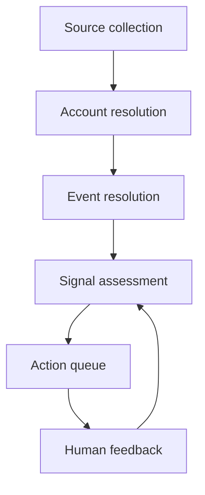

The right week-one product is an account-centered event monitor, not a buyer-intent prediction system.

It should produce four daily outputs:

1. Newly discovered nonprofit accounts.
2. New events associated with known accounts.
3. Evidence-backed commercial hypotheses.
4. A short action queue for investigation or outbound preparation.

Public news, filings and organization updates can establish change, pressure, expansion, funding, leadership movement and operational context. They usually cannot establish consulting budget, purchasing authority or willingness to hire Autonomy Bridge. Mature commercial systems reserve “high intent” for direct behavioural evidence such as website visits, pricing-page activity, ad engagement, product usage or outreach response. Public news events are generally treated as lower-intent context. [Sales Navigator Help](https://www.linkedin.com/help/sales-navigator/answer/a1325209?utm_source=chatgpt.com)

## The research conclusion

The strongest documented design pattern has six separate stages:



The separation matters. Our Greater Vancouver Food Bank mistake came from collapsing several questions into one approval decision.

| Question | Evidence needed | Result for Greater Vancouver |
|---|---|---|
| Is this a real eligible account? | Current registry, official identity evidence | Yes, include it |
| What is its historical financial context? | T3010 filings | Useful but lagging |
| Is there a current change or pressure event? | Recent dated evidence | Evaluate separately |
| Does the event imply a potential need? | Event plus explicit reasoning | Hypothesis |
| Can it buy consulting help now? | Budget, procurement or direct engagement evidence | Usually unknown |

CRA’s current charity listing is specifically intended to show whether an organization is registered, revoked, annulled, suspended or penalized. T3010 returns provide financial and activity information for prior fiscal periods. Those are different functions. [Canada.ca](https://www.canada.ca/en/revenue-agency/services/charities-giving/charities/information-about-a-charity.html?utm_source=chatgpt.com)

Therefore:

- Account admission must not depend on a recent signal.
- A stale filing must not invalidate a currently registered account.
- Weak commercial evidence must not remove the account from monitoring.
- “Unknown” must remain a valid value for budget, authority and willingness.

## What established systems do

### 1. They resolve accounts before scoring signals

Record-linkage practice separates definite matches, possible matches and non-matches. It does not force every uncertain pair into a binary decision. [census.gov](https://www.census.gov/library/working-papers/2000/adrm/rr2000-05.html?utm_source=chatgpt.com)

For Tributary:

- Use CRA business number or US EIN as the strongest identifier.
- Use official domain, normalized name, city and jurisdiction as secondary fields.
- Put ambiguous matches in a resolution queue.
- Never auto-merge organizations solely because names are similar.
- Never block a clearly identified account because one evidence source is incomplete.

The Canadian and US official datasets are suitable for building the account universe. CRA exposes registration and T3010 information, while IRS TEOS and its Business Master File provide exempt-organization identity data. The IRS BMF extract is produced monthly. [Internal Revenue Service](https://www.irs.gov/charities-non-profits/tax-exempt-organization-search?utm_source=chatgpt.com)

### 2. They distinguish documents from events

Several articles can describe the same underlying event. News-processing research treats “first story detection,” event tracking and cross-document event resolution as different tasks. [NIST](https://www.nist.gov/publications/topic-detection-and-tracking-evaluation-overview?utm_source=chatgpt.com)

This means Tributary needs:

- `source_document`: the page or filing retrieved.
- `event`: the real-world occurrence.
- `account_event`: the organization’s relationship to the event.
- `signal_assessment`: why that event could matter commercially.

Without this separation, five articles about one funding announcement become five signals. Near-duplicate research documents both analyst burden and downstream bias from retaining redundant news as independent observations. [ACL Anthology](https://aclanthology.org/2020.lrec-1.156/?utm_source=chatgpt.com)

Week one does not need an advanced clustering model. Use:

- Canonical URL and exact-content hash.
- Normalized headline similarity.
- Same organization.
- Same event type.
- Close event dates.
- Manual merge option.

### 3. They use change, recurrence and baselines

Bombora’s documented intent design looks for elevated activity relative to an organization’s historical baseline. It considers the number of events, number of users, topic relevance and engagement depth, rather than treating one topic mention as intent. [customers.bombora.com](https://customers.bombora.com/hubfs/%21MASTER_Bombora-Company%20Surge%20User%20Guide-January%202023.pptx%20%282%29.pdf?utm_source=chatgpt.com)

We cannot reproduce that form of behavioural intent with public nonprofit data. We can apply the underlying pattern:

- One article is an observation.
- Repeated related events form an episode.
- A material change from the account’s own history is stronger than a generic keyword.
- Independent corroboration strengthens evidence.
- Direct first-party behaviour, if available later, should outrank public context.

Week one should begin accumulating history, not pretend that a baseline already exists.

### 4. They retain provenance

Every conclusion should be traceable to the source entity, the processing activity and the agent or rule that produced it. This is the core structure of the W3C provenance model. [w3.org](https://www.w3.org/TR/prov-o/?utm_source=chatgpt.com)

The minimum retained record is:

| Field | Purpose |
|---|---|
| Source URL and publisher | Where the evidence came from |
| Published date | When the claimed event was reported |
| Retrieved time | When Tributary observed it |
| Content hash | Detect revisions and duplicates |
| Short evidence passage | Support the extracted claim |
| Account ID | Organization resolution |
| Event ID | Underlying occurrence |
| Extraction rule/version | Reproduce the result |
| Human decision and reason | Learn from review |

We do not need the full formal W3C ontology. We need its separation of source, transformation and conclusion.

### 5. They separate alert priority from stored information

Google’s operational alerting guidance divides events into immediate action, next-business-day action and informational records. It warns that low signal-to-noise creates alert fatigue. [Devops On-Call](https://sre.google/workbook/on-call/?hl=ca\&utm_source=chatgpt.com)

Tributary should use the same operational distinction:

| Tier | Meaning | Treatment |
|---|---|---|
| Act | Evidence supports a concrete next step | Daily outbound worklist |
| Investigate | Potentially relevant, one material gap | Daily research queue |
| Monitor | Valid account or event, insufficient urgency | Retain and watch |
| Suppress | Duplicate, irrelevant or demonstrably wrong | Hide, retain reason |

A valid organization does not have to be in the `Act` tier. This is how we go wide without overwhelming you.

### 6. They evaluate surfaced positives, not generic accuracy

Useful commercial events will be rare relative to everything collected. In imbalanced datasets, overall accuracy and ROC-style measures can conceal large numbers of false positives. Precision-recall directly measures how many surfaced positives are actually useful. [PLOS One](https://journals.plos.org/plosone/article?id=10.1371%2Fjournal.pone.0118432\&utm_source=chatgpt.com)

The week-one metrics should be:

- **Worklist precision:** percentage of `Act` and `Investigate` items you judge worth seeing.
- **Discovery yield:** valid new accounts per source run.
- **Duplicate rate:** repeated documents or events that reach the worklist.
- **Resolution error rate:** documents attached to the wrong account.
- **Freshness:** time from publication to appearance in Tributary.
- **Review load:** items requiring your judgment per useful item.
- **Source health:** successful, unchanged, failed and blocked retrievals.

Recall can only be estimated against a manually reviewed sample or a defined test collection. TREC’s evaluation practice also requires judgments to correspond to the exact document collection being evaluated. [English Relevance Judgements](https://trec.nist.gov/data/reljudge_eng.html?utm_source=chatgpt.com)

## Approaches with documented or evident failure modes

| Avoid | Why |
|---|---|
| Keyword match equals signal | A mention does not establish the account, event, materiality or commercial relevance |
| Public event equals buyer intent | Mature systems classify direct engagement much more strongly than general news |
| One opaque AI score | It conceals whether ranking came from fit, freshness, evidence or speculation |
| One article equals one signal | Syndication and rewrites inflate apparent activity |
| Binary approve/reject workflow | It forces uncertain but valid accounts out of the system |
| Latest filing required for account admission | It confuses identity with current operational evidence |
| Fuzzy name auto-merging | Similar nonprofit names can represent different legal entities |
| Reprocessing all history every day | It wastes compute and creates duplicate opportunities |
| Showing every detected item | It causes review fatigue and destroys confidence |
| Assistant reviewing its own output as “verification” | Traceability improves, but independence does not |
| Training a predictive model immediately | There is no stable outcome definition or sufficient labelled history |
| Ranking by outbound replies alone | Replies reflect messaging, channel, timing and who was contacted, not just signal quality |

Incremental collection should use feeds, sitemaps and conditional HTTP requests where available. HTTP validators such as `ETag`, `If-None-Match` and `If-Modified-Since` exist specifically to avoid transferring unchanged content and to limit traversal to recently changed resources. [rfc-editor.org](https://www.rfc-editor.org/rfc/rfc9110.html?utm_source=chatgpt.com)

## The seven-day build

The existing plan remains directionally right, with two changes:

1. Add an explicit event layer between evidence and findings.
2. Replace approval gating with operational tiers.

| Day | Deliverable |
|---|---|
| **1, completed** | Account worklist and separated identity, eligibility, signal and commercial relevance |
| **2** | Source registry and incremental collectors for official registries, organization sites, funder pages and selected local news |
| **3** | Batch account resolution plus document deduplication and event grouping |
| **4** | Deterministic signal rules with evidence, event date, confidence components and explicit unknowns |
| **5** | Daily `Act`, `Investigate`, `Monitor` and `Suppress` queues, plus feedback reasons |
| **6** | Run against real sources, inspect false positives, duplicate events, missed associations and source failures |
| **7** | Produce the first repeatable daily account and signal package, with operating instructions and measured results |

### Week-one signal rules

Start with observable event classes:

- New program, service or geography.
- Material demand or usage increase.
- Funding award, funding loss or fundraising campaign.
- Leadership change.
- Partnership or major commitment.
- Facility opening, closure or relocation.
- Hiring surge or critical vacancy.
- Financial pressure or service reduction.
- Technology, data or operational modernization initiative.
- Public request for vendors, proposals or specialized support.

Each extracted signal should contain:

```text
account
event type
event date
observed fact
source evidence
why it may matter
what remains unknown
action tier
next research or outbound step
```

Do not calculate a universal numeric score in week one. Sort with explicit rules:

1. Account is in scope.
2. Event is recent enough for its type.
3. Evidence directly supports the event.
4. Event maps to an Autonomy Bridge problem area.
5. There is a concrete investigation or outreach step.
6. Independent evidence or recurrence raises priority.

## Preserve these architectural allowances

These cost little now and prevent a rewrite later:

- Stable IDs for accounts, documents, events and assessments.
- Append-only observations rather than overwriting history.
- Separate event date, publication date and retrieval date.
- Separate rule outputs from human decisions.
- Source checkpoints and content hashes.
- Multiple evidence records per event.
- Multiple events per account.
- Explicit `unknown` values.
- Feedback reason codes.
- Versioned extraction rules.
- Component fields for fit, evidence, freshness and access, even if no combined score is used.

If model-based extraction is added later, it should propose structured observations and abstain when unsupported. Production monitoring remains necessary because model behaviour can change with dynamic inputs and real-world data even after pre-deployment testing. [AIRC](https://airc.nist.gov/airmf-resources/playbook/measure/?utm_source=chatgpt.com)

The immediate decision is clear: continue the seven-day build, but treat it as a wide account-and-event collection system with a narrow action queue. Do not build predictive buyer intent, automated outreach, a national-scale crawler or an ML ranking model this week.